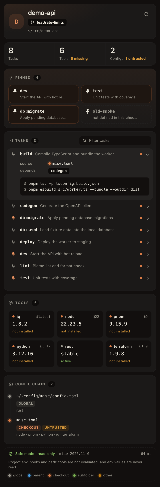
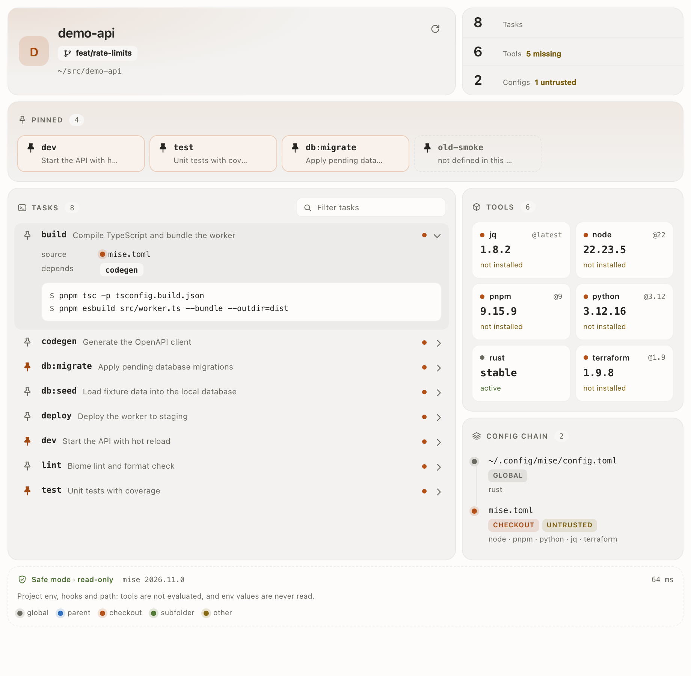

# mise inspector for OpenChamber

See what [mise](https://mise.jdx.dev) applies to the project you're working in, without leaving the chat: its tasks, tools and the config files they come from, laid out as a bento of tiles in OpenChamber's right rail. Pin the tasks you use most and they also show in Work Status.



It only reads. Every read runs in mise's safe mode, so opening a project you haven't reviewed can't run its config. There's no Run button, env values are never read, and the extension asks for no chat or agent permissions.

## Install

In OpenChamber, open **Settings → Extensions**, paste this into **Folder, ZIP, or URL** and choose **Add**:

```text
https://codeberg.org/brahn/openchamber-kit.git#mise-inspector
```

The approval dialog asks to **run a local service** that calls `mise` and `git`. The service reads mise for the panel, because a sandboxed panel can't run programs itself.

Requirements:

- OpenChamber 2.8.0 or newer, on desktop or web;
- `mise` and `git` on the machine OpenChamber runs on.

To update, use **Update** on the extension's card. A new version arrives with each bump of `version`.

## What it shows



| Tile | From | What you get |
| --- | --- | --- |
| Header | git | Project name, branch, and badges for a linked worktree, a subfolder or a mise project outside git |
| Stats | all reads | Counts of tasks, tools and configs; missing tools and untrusted configs are flagged |
| Pinned | extension storage | Your pinned tasks for this project; click one to jump to it |
| Tasks | `mise tasks ls --json` | Filter, pin, and expand a task for its source, aliases, dependencies and script |
| Tools | `mise ls --current --json` | Resolved version, the requested version, and whether it's installed and active |
| Config chain | `mise config ls --json`, `mise trust --show` | Every config file in load order, with where it sits and whether mise trusts it |

The coloured dot beside each item says where it came from:

- **global:** `~/.config/mise` or a config in your home folder;
- **parent:** a folder above the project;
- **checkout:** the project root;
- **subfolder:** a folder inside the project;
- **other:** anywhere else.

The panel follows the project OpenChamber has open. Each git worktree is inspected, and pinned, on its own. When an agent's turn finishes, the panel reads again, so edits to `mise.toml` show up.

### Which folders it inspects

- **A git checkout.** Any folder inside a git working tree, including a linked worktree.
- **A mise project outside git.** A folder inside your home folder whose root has its own mise config. Typical case: a workspace folder that holds tasks and several repos without being a repo itself. The root is the highest folder up from the current one, short of your home folder, that has any of:
  - `mise.toml`, `.mise.toml`, `mise.local.toml` or `.mise.local.toml`;
  - `mise/config.toml` or `.mise/config.toml`;
  - `.config/mise.toml` or `.config/mise/config.toml`.

  Your home folder itself, `~/.config` and `~/Library` never count.

Anywhere else, the panel says there's nothing to inspect.

## Safety

mise config can run code: templates can call `exec()`, and `[env]`, hooks and tool options can run commands. The inspector never lets a project's config do that.

**How mise is started.** Every call starts mise with a fresh environment: only `PATH`, `HOME`, temp and locale come from OpenChamber, plus these settings:

| Setting | Why |
| --- | --- |
| `MISE_SAFE=1` | Safe mode, described below |
| `MISE_AUTO_INSTALL=0`, and the auto-install switches for not-found, exec and task-run | Reading never installs anything |
| `MISE_YES=0` | mise never answers its own prompts with yes |

Settings that loosen trust, such as `CI` or `MISE_TRUSTED_CONFIG_PATHS`, never reach mise.

**What safe mode does.** mise loads the project's config without running it:

- project `[env]`, `[vars]`, hooks, `_.source` and `path:` tools are skipped;
- a template that needs `exec()` or reads files makes mise refuse.

When mise refuses, the affected tile says *Not read: safe mode refused this config* and shows mise's message. The inspector never retries outside safe mode.

**What isn't covered.**

- Safe mode isn't an operating-system sandbox. Your own global config (`~/.config/mise`) is evaluated as in any mise command.
- The local service runs with your user's permissions; OpenChamber's approval dialog says so.

**What the service sends back.** It drops task environments, secrets, tool install paths and every env value before answering the panel. It never calls `mise env`.

**How it uses git.** It only asks `rev-parse` and `symbolic-ref`, which don't trigger repository hooks such as `core.fsmonitor`.

**What else it limits.**

- Every subprocess is started without a shell and without input.
- Each mise call is stopped after 8 seconds or 4 MB of output.
- At most four run at a time.
- A call that is stopped shows as an error, never as partial data.

**What's stored.** The only thing saved is your pinned task names for each project folder, in OpenChamber's extension storage on the server.

## Tested

- **Safe mode,** against real mise 2026.11.0 (`tests/safety.test.ts`):
  - Projects whose config tries every way of running code (`[env]` and `[vars]` templates, `_.source`, hooks, `postinstall`, `path:` tools, TOML and file tasks) are read with no code run. Each of those writes a marker file if mise runs it, and no marker appears, trusted or not.
  - A template that needs `exec()` fails its tile with *safe mode refused*.
  - Without safe mode, the same config did write its markers during a plain `mise tasks ls`.
- **Scopes:**
  - A main checkout and a linked worktree are separate, with their own tasks and pins.
  - A workspace folder outside git resolves to its mise root, and a repo inside it stays a git checkout.
  - Relative, missing and unrelated folders are refused.
- **Live:** installed in OpenChamber 2.8.0 desktop on macOS. The panel and the Work Status section render, and mise was found on the service's own `PATH`.
- **Design:** rendered with OpenChamber's dark and light theme tokens at 380, 440 and 920 px, including the error states.

Still to verify live: pins surviving a reload, pins syncing between the panel and Work Status, and switching worktrees in the app.

## Notes

- **Finding mise.** The service gets only part of OpenChamber's environment. If `PATH` lacks mise, the service looks in the usual install folders (Homebrew, `~/.local/bin`, `~/.local/share/mise/bin`, `~/.cargo/bin`), and the panel's footer says *found outside PATH*.
- **Where pins live.** Pins are kept per OpenChamber server, not per device.
- **On a phone.** The panel isn't laid out for phones; the Work Status section shows there on its own.

## Develop

This folder is one mod in [openchamber-kit](https://codeberg.org/brahn/openchamber-kit).

```sh
bun install
bun run check     # typecheck, tests (needs mise and git), build
bun run preview   # screenshots against a mock host; see tools/preview
```

What's where:

| Path | Holds |
| --- | --- |
| `src/service/` | The local service: finding mise, validating the folder, the bounded runner, normalizing mise's output |
| `src/panel/`, `src/status/` | The two frames |
| `src/client/` | Code the frames share |
| `src/shared/types.ts` | The contract between the service and the frames |
| `panel/`, `status/`, `service/` | The built files OpenChamber loads. They're committed, because OpenChamber installs without building |

Inspired by the mise-deck mod for Herdr.

## License

MIT
